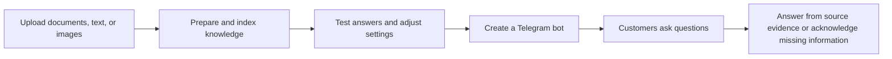
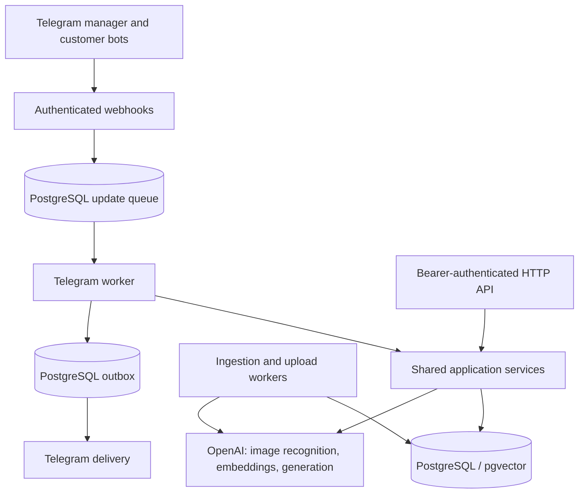

# Say AI

[](https://github.com/kaprielov/say-ai/actions/workflows/ci.yml)

Create Telegram bots that answer questions from your documents, text, and images.
Say AI handles knowledge ingestion, retrieval, and bot management through a Telegram
manager interface and a developer HTTP API.

**Status:** personal project in active development, preparing for a small user pilot.
The pilot runs on the developer's machine; there is no always-on public demo.

## What it does

A shop owner can upload delivery policies and a size chart, test questions against
that material, then create a Telegram bot to share with customers. Owners connect
their own OpenAI API keys through a Telegram Mini App; English and Russian manager
interfaces are supported.



- Collect up to ten files or text messages per upload, including PDF, Word, and
  standalone JPEG, PNG, or WebP images. Image recognition extracts text and tables.
- Replace knowledge-base content while keeping the previous ready version available.
- Configure answer style, retrieval context, bounded dialogue memory, and visitor limits.
- Inspect test-answer context and generation requests; review estimated provider spending.
- For the catalog pilot, answer about a selected product using its current database
  stock and measurements, with synthetic stock explicitly marked as test data.

## Engineering decisions

| Problem | Implementation and tradeoff |
| --- | --- |
| Keep answers available during content updates | Versioned content; activate the new version and complete its task in one transaction. Failed replacement preserves the previous ready version. |
| Recover work after a restart | PostgreSQL-backed ingestion, Telegram update queues, and an outbox with bounded retries. No separate message broker; external delivery can still duplicate after a crash. |
| Keep owners' data and credentials separate | Owner-scoped queries and database constraints; encrypted bot tokens and OpenAI keys, captured credential revisions, authenticated webhooks and Mini App requests. |
| Bound slow or expensive work | Admission limits, deadlines, cancellation, token budgets, and isolated parsing/decoding processes. Limits are implementation controls, not measured throughput guarantees. |
| Make generated answers inspectable | Version-scoped retrieval, source IDs and link validation, plus owner-only test diagnostics. Valid source IDs do not establish factual correctness. |

## Architecture

Node.js · TypeScript (strict mode) · Express · PostgreSQL 17 / pgvector · OpenAI · Telegram Bot API



The application currently supports one instance with its background workers enabled.
PostgreSQL advisory locks coordinate workers. Retrieval uses exact cosine search;
there is no approximate vector index at the current project scale.

## Run locally

Requires Node.js 22.13+ and Docker Compose. OrbStack or Docker Desktop can provide
Docker on macOS. Run these commands from the repository root:

```sh
npm ci
cp .env.example .env
npm run db:up
npm run db:migrate
npm run db:check
```

Generate a developer API key, put it in `DEVELOPER_API_KEY` in `.env`, and set a stable
`DEVELOPER_OWNER_ID`:

```sh
node -e "console.log(require('node:crypto').randomBytes(32).toString('base64url'))"
npm run dev
```

The API listens at `http://localhost:3000`; `GET /health` checks database connectivity.
No provider key is needed for the health check or deterministic tests. For actual
HTTP ingestion and answers, set `OPENAI_API_KEY`. Telegram additionally needs a
manager token, webhook secret, encryption key, and public HTTPS access: follow the
[Telegram setup](docs/reference.md#setup).

## Verify

With the local Compose database running and migrated:

```sh
npm run build
npm test
```

`npm test` discovers all `tests/*.test.mjs` files and forces the query, embedding,
and image live-test flags to `false`, even if enabled in `.env` or the shell.
It uses controlled provider/Telegram transports and real PostgreSQL/pgvector.
No real API keys or Telegram tokens are needed.

Use a local development/test database in `DATABASE_URL`. Most suites create and
drop isolated databases, so the role needs database creation permission. Schema
tests use the configured migrated database and roll back their fixtures. The
[CI workflow](.github/workflows/ci.yml) provisions a fresh PostgreSQL/pgvector
service, installs locked dependencies, builds, migrates, and runs the same suite.

Passing deterministic tests demonstrates application contracts, including ownership,
replacement atomicity, retries, and capacity recovery. Paid live checks are separate
and opt-in; representative answer quality, sustained-load latency, and availability
remain to be evaluated.

## Explore the project

- [Development and operations reference](docs/reference.md): API examples, all commands, Telegram setup, limits, and operator checks.
- [System design](system-design.md): current architecture, constraints, and earlier design discussion.
- [Pilot tester guide](docs/pilot/tester-guide.md): the user workflow and current limitations.
- [Test map](.agents/skills/say-ai-testing/references/test-map.md): suite selection and known test limitations.
- [Prompt-injection boundaries](docs/security/prompt-injection.md): implemented defenses and remaining risks.

Useful code entry points: [HTTP API](src/app.ts),
[query pipeline](src/queries/service.ts),
[ingestion processor](src/ingestion/processor.ts), and
[Telegram worker](src/telegram/worker.ts).
