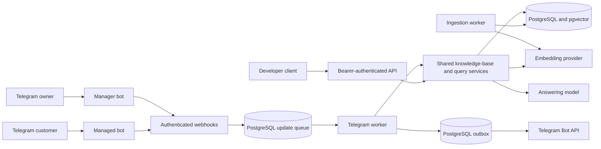
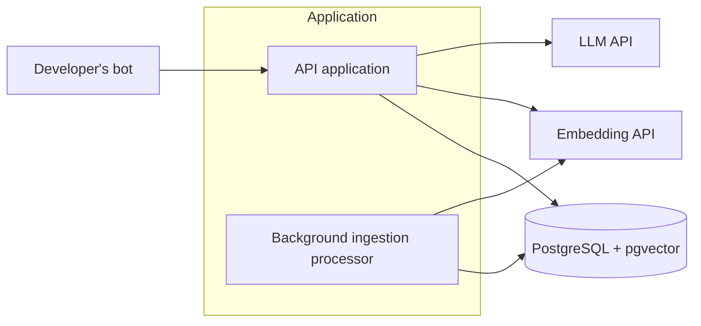

# RAG API: system design notes

Status: RAG API and a Telegram interface are implemented. The current implementation below is authoritative; the numbered sections preserve the original design discussion and may describe superseded proposals.

Updated: 24 October 2026.

### Current implementation

The API now uses Node.js, TypeScript, Express, and PostgreSQL with pgvector. It supports developer API-key authentication, Telegram user ownership, knowledge-base creation/status/replacement, document uploads, question answering, and managed Telegram bots within one application instance. Both entry points call shared application services; management uses the Telegram chat and buttons, with a small server-rendered Mini App for credential entry.

Ingestion uses OpenAI `text-embedding-3-small` with 1536 dimensions by default, configurable for future versions. The `paragraph-sentence-v1` strategy keeps paragraphs separate within 512 `cl100k_base` tokens. Long paragraphs split at sentence boundaries with up to 64 tokens of whole-sentence overlap; oversized sentences fall back to Unicode-safe hard splits and bounded overlap. Separate paragraphs do not overlap. Text remains an exact source substring. The worker embeds sequential batches of 16 and stores model/dimensions/configuration with each attempt version. Existing content must be resubmitted to use the new chunking strategy. Activation and task completion commit atomically. An exclusive database advisory lock protects startup recovery and enforces a single ingestion worker. Partial failed versions are deleted; successful versions are retained.

Transient ingestion failures allow three persisted attempts total, separated by 10 seconds and 60 seconds. Interrupted attempts count toward that total; permanent provider errors fail immediately. Each provider request is bounded by 30 seconds and each attempt by ten minutes. These are implementation defaults, not evidence that the one-hour freshness target has been met.

Question answering is implemented at `POST /knowledge-bases/{id}/queries`, using the captured ready version's embedding configuration and exact cosine retrieval. It ranks eight chunks without a similarity cutoff. Context selection first budgets the three strongest matches, expands them with their next and previous chunks from that same version and knowledge base using at most 1000 additional tokens, and then tries remaining matches. Duplicate chunk IDs are removed; citation text remains unchanged. The complete serialized context stays within 3000 `cl100k_base` tokens. Neighbor expansion applies to existing versions as well. The initial `0.6` filter was removed after it rejected useful opening-hours evidence scoring about `0.37`; the model now assesses answerability from the retrieved context. The selected answering model is GPT-6 Luna through the Responses API, with reasoning disabled, structured answers/refusals, source chunk IDs, response storage disabled, and an output cap of 768 tokens. Responses distinguish grounded answers, short topic redirections, and insufficient context; model citations are checked against supplied chunks. The response contract is described below.

An application-wide query admission limit rejects requests beyond three concurrent queries with `429`. A 30-second total query deadline returns `504`, attempts cancellation, and releases admission. Outstanding downstream work remains tracked after timeout, with a separate cap of six operations to bound abandoned work. Queries are not retried. Synthetic live checks have passed for a supported answer, a greeting, and a missing-information redirection; representative quality, concurrent-load latency, and ingestion freshness targets remain to be evaluated.

Content replacement is implemented at `PUT /knowledge-bases/{id}/content`. It checks ownership, locks the knowledge-base row, and durably saves the complete replacement text and a pending task before returning `202`. The existing partial unique index prevents overlapping pending/processing submissions, which return `409` with `ingestion_in_progress`. Submission timestamps are recorded after acquiring the row lock. Replacement leaves the active version unchanged until the ingestion activation transaction succeeds; existing queries keep their captured version, and terminal failure preserves the previous ready version. A new submission is allowed after terminal failure. Validation, concurrent acceptance, recovery, rollback, and version availability are covered by API/database tests.

### Telegram interface and ownership

The service operates one manager bot and its users' managed bots. A user creates a named knowledge base, sends a supported document or text, receives an ingestion notification, tests answers, and creates a Telegram bot through a native Telegram dialog. Onboarding requires a language choice, then connection of the owner's OpenAI key, before the main menu. The first manager interaction asks the user to choose English or Russian. The nullable `telegram_sessions.language` column records this preference; existing users choose on their next interaction. The menu language button and `/language` command allow later changes and return to the main menu. UI messages, buttons, status cards, errors, asynchronous notifications, and per-chat command descriptions are localized. User content stays unchanged, and model answers follow the question language. The manager requires Bot Management Mode in BotFather. User confirmation creates the bot account; the manager receives `managed_bot`, retrieves its token, verifies its identity, and registers a webhook. End users never copy child bot tokens.

The HTTP developer key maps to `DEVELOPER_OWNER_ID`. Telegram management derives the owner as `telegram:<numeric-user-id>` from authenticated Telegram updates. Every base and bot management action checks this owner. Customer questions resolve the base and its owner from the registered child bot; customer IDs cannot choose or override ownership. A composite database foreign key also prevents binding a bot to another owner's base. This release handles private chats only.

New bots with a selected ready base start enabled and accessible to customers. Creation without a selected ready base leaves the bot paused and restricted to its owner. Explicit pauses survive token refreshes. Changing the selected base pauses answers until re-enabled. An owner transfer detaches the previous base, pauses answers, restricts access to the new owner, and discards queued replies from the previous owner. Base deletion requires ingestion to finish, removes its content, and pauses and disconnects associated bots.

### Implemented architecture



Telegram adds these durable tables to the original knowledge-base/version/chunk/task model:

| Table | Purpose |
| --- | --- |
| `telegram_sessions` | Current management step, selected base, draft name, and interface language for each user. |
| `telegram_bots` | Bot identity, owner, selected base, enabled state, AES-256-GCM encrypted token, and webhook secret. |
| `telegram_updates` | Incoming update payload, retry state, and unique `(bot_id, update_id)` delivery identity. Completed payloads are cleared. |
| `telegram_outbox` | Committed outgoing messages and Telegram API calls with delivery retries. |
| `telegram_notifications` | Ingestion tasks awaiting a completion or failure notification. |
| `owner_openai_keys` | Encrypted OpenAI credential, revision, and validity per owner. |
| `openai_key_attempts` | Per-owner credential validation rate limit. |
| `telegram_usage` | Independent daily admitted customer and test question counts per owner. |

Webhooks verify their secret header before parsing and acknowledge only after persisting the update. One Telegram worker holds its own advisory lock and processes updates in arrival order. Source changes, session changes, outgoing replies, and update completion share a transaction. Transient processing failures receive up to three attempts; a delayed update holds later work. The outbox makes up to five delivery attempts and honors Telegram rate-limit delays. Permanent credential failures can pause the affected child without disabling other bots. PostgreSQL commits and external API calls are not atomic: a crash can duplicate message delivery or a provider call and its charges.

The Telegram worker is sequential; the RAG service still has its separate global query admission limit. A slow Telegram question delays other Telegram updates. Use one application instance with these workers enabled. Telegram owners can hold up to 20 bases. Owner-configurable daily customer and test quotas are independent and default to no quota; admitted provider failures count. Bot owners can configure visitor limits and off-topic escalation, with 15-minute initial and six-hour repeated-abuse pauses by default. Protection state excludes full message text; bounded dialogue memory is stored separately; only clearly off-topic validated redirections count. Repeated-abuse notifications are coalesced in the manager, which also supports unblocking. Mandatory operator controls bound HTTP work, queue depth, outgoing messages, and visitor/owner request rates; see the README for defaults. Bot scheduling preserves per-bot ordering while allowing other bots to proceed during delayed retries. These controls require load testing before their values can be treated as a capacity estimate. Ingestion has its existing retry and timeout bounds; managed Telegram bots can send bounded dialogue history to the answering model. Memory is isolated by bot, user and visitor/test scope, defaults to five pairs with a one-hour idle expiry, and is configurable or disabled in the manager. History resolves conversational references but never supplies factual evidence. HTTP queries remain stateless.

Manager navigation uses compact inline panels with context-specific Back actions. Callback-driven panels queue `editMessageText` instead of new messages; unchanged edits complete without duplicates, and uneditable panels fall back to `sendMessage`. Messages requiring native reply keyboards still use normal sends. Spam settings are grouped with concise hints, quick values, and optional detailed help. Account controls live under Settings; data lists use five-item pages. The base picker includes the bot identity in callbacks to avoid binding through stale session context. See the README for the interaction details and reference guidance.

### Owner provider credentials

A small HTML form is served by Express and opened with an inline `web_app` button. It posts the key and Telegram `initData` directly to the server. The backend verifies the HMAC signature with the manager token, a ten-minute maximum age, and a bounded future-clock allowance. Only the signed Telegram user selects the owner. The endpoint requires a matching Origin, bounds the JSON body, disables caching, and never returns the key. It validates embeddings and GPT-6 Luna access with two small billable requests, rate-limited to three attempts per owner per minute. A failed replacement preserves the previous credential.

Credentials use AES-256-GCM with a domain-separated key derived from the existing server master secret. No plaintext credential enters the general Telegram queue. Unexpected key-like strings in incoming updates are redacted before persistence; pasted manager messages are scheduled for deletion. API logs and responses exclude key values. The manager supports replacement and confirmed removal in both interface languages.

Question answering resolves the owner key after checking the base and its ready version, capturing one credential for embedding and generation within the existing deadline. Ingestion captures an owner-specific embedder per attempt after claiming its task. The ingestion worker runs with Telegram enabled even if the shared provider key is absent. Developer HTTP bases retain the server key; Telegram bases never fall back to it. Unauthorized or forbidden provider responses invalidate only the credential revision used by that request, preserving newer replacements. Removing a key blocks future operations but cannot cancel provider work already in flight. Reconnecting a key leaves ready embeddings intact; failed ingestion needs a new content submission.

### Answer behavior

| Outcome | Behavior | Source validation |
| --- | --- | --- |
| `answered` | A factual answer supported by the retrieved evidence. | Requires supplied chunk IDs supporting the answer. |
| `redirected` | A greeting, capability reply, or acknowledgment of missing information followed by one or two useful topics from the base. | Requires supplied chunk IDs supporting the suggested topics, rather than the original unsupported question. Replies above 280 Unicode code points are rejected. |
| `insufficient_context` | No safe topic can be suggested, or retrieval is empty. Returns `answer: null` and no sources. | Empty retrieval avoids a generation call. |

Prompts request the user's language and at most two short sentences for a redirection. They prohibit inventing an answer to an unsupported question. Valid citations check source identity, not semantic truth; representative review is still necessary. Telegram forwards valid answers and redirections, supplies a brief fallback for insufficient context, and replaces internal generation/validation failures with a neutral retry message. The HTTP API retains its explicit processing errors.

### Development publication and verification

`npm run dev:public` starts a Cloudflare Quick Tunnel, waits for its URL and connection, then launches the backend with `TELEGRAM_PUBLIC_URL` injected into its environment. It does not rewrite `.env`. Ctrl+C stops both processes. On startup, the backend registers the manager and every stored child bot webhook with the current public URL, so restarting a temporary tunnel does not require manual URL copying or webhook updates. Webhook and token-encryption secrets remain stable in `.env`; the daily quota is optional. See [README setup](README.md#telegram-interface).

A real development tunnel, public health endpoint, manager webhook registration, and rejection of unsigned webhook requests have been checked. A real managed bot was created and answered a store-hours question. Automated Telegram tests use controlled transports and isolated databases, including ownership, automatic activation, pause preservation, transfer, retries, and topic redirections. A synthetic live RAG check verifies supported answers and greeting/missing-information redirections. Sustained traffic, representative multilingual quality, and production availability remain unevaluated.

## Original design discussion

The numbered sections below record the initial developer-API scope and the options considered before Telegram management and conversational redirection were implemented. Statements that an implementation choice remains open or Telegram operation is out of scope describe that earlier stage. Use the current implementation above and the README for present behavior.

## 1. Context and scope

Build a RAG service with an API that developers can use to create chatbots without implementing the retrieval and generation infrastructure themselves. Use this project to practise system design while building the service.

The MVP serves one developer. Every knowledge base still has an owner, and API access is checked against that owner.

Developers operate their own bots and call this API. Telegram is the initial integration use case; operating Telegram bots is outside the service's responsibilities. Non-technical chatbot users interact with the developer's bot rather than directly with this API.

## 2. Functional requirements

### Confirmed behavior

1. The developer can create a knowledge base and submit plain-text content.
2. The developer can submit a question against a selected knowledge base and receive an answer based on its content.
3. Answers are returned as complete responses, without streaming.
4. If the knowledge base contains insufficient information to answer a question, the service declines to answer.
5. Access to a knowledge base is checked against its owner.
6. Submitting updated content replaces the complete content of that knowledge base rather than appending to it.
7. While replacement content is processing, questions use the previous ready version if one exists. If no ready version exists, querying returns an error.
8. Reject another content replacement for the same knowledge base while an ingestion task is pending or processing.

### Processing status

- The API draft includes checking processing status. The exact status fields and whether they use a separate endpoint remain under review.

### Feature still under consideration

- The original draft requested a choice of LLM models. Whether the MVP supports multiple models, and how the developer selects one, remains undecided.

## 3. Scale and non-functional requirements

| Area | Agreed target or assumption |
| --- | --- |
| Knowledge bases | 20 |
| Content volume | 100 pages per knowledge base |
| Query concurrency | Up to 3 questions being processed at once globally, across all knowledge bases; reject additional requests immediately with `429 Too Many Requests` |
| Answer latency | Maximum 30 seconds; no streaming |
| Ingestion freshness | Submitted text becomes available for questions within a maximum of 1 hour |

Plain text has no fixed page size. The page estimate must be translated into bytes or tokens if a later capacity decision requires it.

The agreed 30-second deadline covers the full query, including embedding, retrieval, and generation. On timeout, return an explicit error, attempt to cancel the model call, and do not automatically retry within that request. The exact timeout HTTP code and response body remain open. Cancellation may not stop provider-side execution or charges.

Declining unsupported questions is required behavior. Start with manual answer-quality evaluation using a repeatable question set (section 12). Numerical quality and latency success-rate targets remain open.

## 4. Additional goals and implementation preferences

These came from the initial requirements draft and remain relevant, but they are not yet fully specified:

- **Context efficiency:** construct a prompt containing general rules, relevant knowledge-base context, and the user's question while avoiding unnecessary context. Context budgets and quality criteria remain undefined.
- **Advance ingestion:** prepare the knowledge base before question requests. Generating embeddings in advance was the original implementation idea; the user-facing target is the ingestion freshness requirement above.
- **Observability:** provide analytics comparable to Langfuse. Required traces, metrics, retention, and tooling have not been selected.
- **Reuse:** evaluate existing solutions such as LlamaIndex. This is an implementation preference, not a committed framework choice.

## 5. Out of scope

- User interface.
- Billing.
- Hosting or operating messenger bots.
- Queues and external queue infrastructure. The chosen MVP approach uses database task records and background processing within the same application.

## 6. Core entities: provisional discussion

This step identifies the main concepts needed by the system. It does not finalize database tables, storage technology, or every field.

| Concept | Current position |
| --- | --- |
| `KnowledgeBase` | Clearly a core entity: an owned collection of content used to answer questions. Vector storage is an implementation detail, rather than its complete definition. |
| `KnowledgeBaseStatus` | Proposed as state on the knowledge base rather than an independent entity. Status values and transitions have not been finalized. |
| `AugmentedPrompt` | The combination of rules, retrieved context, and a user question. Proposed as data assembled during a request; independent persistence is not required by current requirements. |
| Owner identity | Ownership and access checks are required. The identity may be represented by a developer or account; a separate `Owner` entity has not been agreed. |
| `Document` | An optional suggestion for giving each plain-text submission its own identity. It has not been adopted as a core entity. Its usefulness depends on how submissions are managed. |
| `IngestionTask` | Follows from the developer's chosen processing approach: a persistent record of ingestion work and its status, used for background execution and startup recovery. Exact fields remain to be designed. |

`Owner` and `Document` were suggestions derived during this project's discussion. They are not a prescribed Hello Interview pattern.

The provisional entity list now includes `KnowledgeBase` and `IngestionTask`. Refine it as API design and data flow reveal additional needs.

## 7. Open decisions

These can be resolved as the design develops; they do not all need to block the first API draft.

- What delay or backoff should separate ingestion attempts? The three-attempt limit is agreed.
- How are retries made safe after partially stored results or interrupted version activation? Restarting ingestion from the beginning is agreed; cleanup and atomic activation mechanisms still need implementation design.
- Which backend framework, database deployment, embedding model, and answering model should be selected? Section 11 records recommendations, not confirmed choices.
- Does the MVP need knowledge-base deletion?
- Does the MVP support multiple LLM models?
- What exact response bodies represent insufficient evidence, an unready knowledge base, a timeout, or excess concurrent requests? Timeout HTTP status remains open; concurrent-query rejection uses `429` and overlapping replacement rejection uses `409`.
- Are questions and answers persisted, or retained only through observability traces?
- What answer-quality, latency reliability, and availability targets are appropriate?

## 8. API draft

### Agreed behavior

- Developers create knowledge bases with plain-text content, inspect their status, and submit questions.
- Content replacement replaces all content under the existing knowledge-base identity.
- Queries use the previous ready version while replacement content is being processed. Queries fail if no ready version exists.
- Access is authenticated and checked against ownership.
- Developers poll knowledge-base metadata for readiness. Replacement requests are rejected while ingestion is pending or processing for that knowledge base.

### Proposed endpoint contract

The names, HTTP codes, and response fields below are review suggestions, not a fully agreed contract. They revise the developer's original `/knowledge-base` and `/query` draft.

| Method and path | Purpose | Proposed success response |
| --- | --- | --- |
| `POST /knowledge-bases` | Create a knowledge base from `{ "text": "..." }` | `201 Created` with its ID and initial processing status |
| `GET /knowledge-bases/{id}` | Read metadata and processing status | `200 OK` with its ID, processing status, and query availability |
| `PUT /knowledge-bases/{id}/content` | Submit `{ "text": "..." }` to replace all content asynchronously | `202 Accepted` with processing status |
| `POST /knowledge-bases/{id}/queries` | Submit `{ "question": "..." }` | `200 OK` with an answer or an explicit insufficient-context outcome |

The developer originally proposed a separate `GET /knowledge-base/{id}/status` endpoint. Including status in the knowledge-base metadata response was suggested as a simpler alternative; either shape remains possible.

The server assembles the augmented prompt from rules, retrieved context, and the question. Accepting a question instead of a fully assembled prompt is a proposed revision to the original API draft.

### Processing status and query availability

These need to be represented separately: replacement content can be processing while a previous version remains queryable. A proposed metadata response is:

```json
{
  "id": "kb_123",
  "status": "processing",
  "queryable": true
}
```

Here, `status` describes the latest content submission; `queryable` indicates whether a ready version exists. Proposed states are `pending`, `processing`, `ready`, and `failed`. These names are not finalized.

If no ready version exists, a proposed query response is `409 Conflict`:

```json
{
  "error": {
    "code": "knowledge_base_not_ready",
    "message": "No ready version is available for queries."
  }
}
```

Insufficient evidence is different from an unready knowledge base. The former is an expected refusal outcome after querying usable content; the latter prevents the query from being processed.

Keeping the previous ready version available implies building replacement content separately and switching the active version only after successful processing. The mechanism, failure handling, version cleanup, and treatment of in-flight queries belong to the later design.

### Replacement already in progress

Reject a replacement with `409 Conflict` when the same knowledge base already has pending or processing ingestion work. The behavior and HTTP status are agreed; the proposed error code `ingestion_in_progress` and response body remain suggestions.

The check and creation of the new task must prevent two simultaneous requests from both being accepted. The database mechanism remains to be designed.

### Query concurrency and timeout behavior

- Enforce a global limit of three concurrent questions across all knowledge bases, not three per knowledge base.
- Reject an additional question immediately with `429 Too Many Requests`; do not place it in a waiting queue. The developer's bot handles rejection and may retry later.
- Enforce a 30-second deadline over the query work, including embedding, retrieval, and generation.
- On timeout, return an explicit timeout error and attempt cancellation. Do not automatically retry within the request.
- Release the request's concurrency slot on completion, failure, or timeout. Track any provider calls still running after cancellation separately so abandoned work does not silently accumulate.
- For one application instance, a shared in-memory counter was proposed. Multiple instances would need coordinated enforcement; the mechanism is not yet selected.

## 9. Ingestion data flow

### Chosen execution approach

The developer selected the following approach:

1. Save the task and its status in the database before returning `202 Accepted` for a replacement submission.
2. Process the task in the background within the same application.
3. On application startup, find unfinished tasks and retry them.
4. Reject additional replacements for the same knowledge base while work is pending or processing.

### Working sequence

1. Authenticate the caller, check knowledge-base ownership, and validate the submitted plain text.
2. Reject the request if this knowledge base already has pending or processing ingestion work.
3. Durably save the replacement text and a pending ingestion task before acknowledging acceptance. Exact persistence details remain to be designed.
4. Return `202 Accepted`; the developer can poll `GET /knowledge-bases/{id}` for progress.
5. Background processing claims the task and splits the text into chunks.
6. Generate an embedding for each chunk, retaining the association between each vector and the exact chunk text that produced it.
7. Store the chunks and vectors for the new version without exposing partially processed content to queries.
8. After successful processing, activate the new version and mark the task complete. Queries use the previous ready version until activation; if none exists, queries return an error.
9. On startup, recover unfinished tasks from the database.

Version identifiers and a switch of the active version are proposed mechanisms for preserving the previous ready content during replacement; their concrete implementation is not yet selected.

### Agreed recovery policy

- Restart interrupted or failed ingestion from the beginning rather than resuming at a particular chunk.
- Allow three attempts total: one initial attempt and up to two retries. Startup recovery must respect this persisted total rather than resetting it.
- After the third failed attempt, mark ingestion as `failed`, expose the failure through status, and stop automatic retries for that submission.
- Keep the previous ready version available throughout processing and after terminal failure. If no ready version exists, queries remain unavailable.

The trade-off is simpler recovery at the cost of repeated chunking and potentially repeated embedding charges.

### Proposed recovery sequence

1. Find unfinished ingestion after startup, or retry after a processing failure while the application remains running.
2. Check the persisted attempt count before starting another attempt.
3. Discard or isolate incomplete results from the failed attempt without removing the active ready version.
4. Reprocess the saved replacement text from the beginning.
5. Activate the replacement only after all required chunks and vectors are successfully stored.

### Recovery mechanisms still to design

- Retrying after partial progress must not create duplicate or mixed-version results.
- Recovery must account for a crash between activating a version and recording task completion.
- Choose retry delays, task-claiming rules, and the exact persistence of attempt counts.
- Interrupted attempts must count toward the total. A crash during activation must not cause a completed active version to be deleted as though it were an incomplete attempt.

## 10. Query data flow

### Developer's draft

1. Validate the question.
2. Convert the question into a vector.
3. Find the top matches.
4. Send the complete prompt, containing general rules, retrieved chunks, and the question, to the LLM.
5. Receive the answer and return it to the caller.

### Review refinements

These apply existing requirements to the draft; the concrete mechanisms remain to be selected.

- Authenticate the caller and verify ownership before accessing knowledge-base content.
- Resolve a ready version for the request; return an error if none exists. Use one version throughout retrieval so replacement does not mix old and new content. Retention of versions used by in-flight queries remains to be designed.
- Embed the question using a model compatible with the embeddings stored for that version.
- Scope retrieval to the selected knowledge base and ready version. Top matches must return their associated chunk text for prompt construction.
- Select context within a token budget rather than blindly including every retrieved chunk. Retrieval count, selection strategy, and budget are not yet specified.
- Similarity search returns the nearest available matches even when they cannot answer the question. The system must still support declining for insufficient evidence. The evidence assessment and refusal mechanism are open design decisions.
- The developer proposed cosine similarity with a refusal threshold of `0.6`. A working interpretation is to filter retrieved chunks below the threshold and decline if none remain. This aggregation rule is a review suggestion; the numerical threshold is provisional and must be evaluated with the selected embedding model and representative questions. A high similarity score alone does not establish that a chunk contains the answer.
- Bound the full request, including embedding, retrieval, and generation, by the agreed 30-second deadline. Apply the global concurrency limit and timeout behavior in section 8; exact timeout error details remain open.

## 11. Proposed architecture and technology options

This is the starting architecture suggested in discussion. It is not a finalized technology selection.



- **API application:** authenticates callers, validates inputs, checks ownership, accepts content, exposes status, and handles questions.
- **Background ingestion processor:** finds saved work, chunks text, generates embeddings, stores results, and activates completed versions. It initially runs within the same application.
- **Database:** stores knowledge-base metadata, ownership, source text, ingestion state, chunks, and vectors if pgvector is selected.
- **Embedding API:** converts chunks during ingestion and questions during retrieval into compatible vectors.
- **LLM API:** receives rules, retrieved text, and the question; produces an answer or an insufficient-context outcome.

### Recommendations discussed, not yet selected

| Area | Options and recommendation | Trade-off |
| --- | --- | --- |
| Backend | Express with TypeScript is sufficient for the MVP; NestJS offers established application conventions. FastAPI with Python was also compared. | Express requires choosing application structure; NestJS introduces additional framework concepts. Python may fit preferred RAG libraries, while TypeScript may fit developer familiarity. |
| Storage | PostgreSQL with pgvector is the proposed starting point. | One database simplifies operation and version switching, but ingestion, vector search, and metadata operations share resources. |
| Embeddings | `text-embedding-3-small` was recommended as an initial baseline. `text-embedding-3-large` and Voyage `voyage-4` were alternatives to evaluate. | Retrieval quality must be measured on representative content; changing to an incompatible embedding model requires re-embedding stored content. |
| Answering | `gpt-6-luna` was recommended as a hosted baseline, initially with reasoning disabled. `gpt-4.1-mini` and `gemini-3.5-flash-lite` were comparison candidates. | Provider documentation does not prove grounded-answer quality or compliance with this system's 30-second deadline. |

Model research was performed on 21 October 2026. Availability and pricing should be checked when implementing. No model calls or workload benchmarks were performed during that research. Store embedding model and dimensions with a knowledge-base version; keep answering-model selection independent of embedding selection.

References used for technology comparisons and model research:

- [Express](https://expressjs.com/) and [NestJS](https://docs.nestjs.com/).
- [FastAPI features](https://fastapi.tiangolo.com/features/) and [background tasks](https://fastapi.tiangolo.com/tutorial/background-tasks/).
- [pgvector](https://github.com/pgvector/pgvector) and [PostgreSQL transactions](https://www.postgresql.org/docs/current/tutorial-transactions.html).
- [OpenAI embeddings](https://developers.openai.com/api/docs/guides/embeddings), [GPT-6 Luna](https://developers.openai.com/api/docs/models/gpt-6-luna), and [GPT-4.1 Mini](https://developers.openai.com/api/docs/models/gpt-4.1-mini).
- [Voyage embeddings](https://docs.voyageai.com/docs/embeddings) and [Gemini pricing and model options](https://ai.google.dev/gemini-api/docs/pricing).

## 12. Initial evaluation and implementation approach

### Answer-quality evaluation

Begin with manual review of a small, repeatable set of questions and expected results from a representative knowledge base. A script may submit questions and record outputs; manual evaluation does not require manually making every API call.

A proposed initial set contains 20 questions:

- Eight questions clearly answered in the source text.
- Six answerable questions phrased differently from the source.
- Six questions whose answers are absent and should produce a refusal.

For each question, record the expected answer or refusal and supporting passages when present. Review retrieval and generation separately: did retrieved chunks contain the evidence, and did the answer use it correctly without adding unsupported claims? Record complete response time and evaluate with three concurrent requests. Repeat the set after changes to chunking, embeddings, prompts, or answering models. The exact sample counts are suggestions; measurable acceptance thresholds remain open.

Ownership, state transitions, retries, response formats, concurrency limits, and timeouts can be checked with automated tests independently of manual answer-quality evaluation.

### Implementation readiness

The current design is sufficient to begin an MVP once technology choices are settled. The suggested first implementation path is submitting text, processing it, checking readiness, and querying it for an answer or refusal. Then add and verify replacement versions, recovery, and concurrency/deadline enforcement before considering the agreed MVP behavior complete.

## 13. Learning framework and references

The project follows Hello Interview's broad progression:

1. Requirements — initial baseline recorded above.
2. Core entities — provisional discussion recorded above.
3. API or system interface — draft recorded above; under review.
4. Data flow — ingestion and query drafts recorded above.
5. High-level design — proposed components and connections recorded above; technology selection remains open.
6. Deep dives — ingestion recovery, overlapping replacements, query deadlines, concurrency, and initial quality evaluation discussed above.

References inspected during the discussion:

- [System Design Delivery Framework](https://www.hellointerview.com/learn/system-design/in-a-hurry/delivery): recommends a focused requirements list, provisional core entities, API design, and then architecture. Its core-entity example is `User`, `Tweet`, and `Follow`; it does not prescribe RAG entities.
- [System Design Requirements Gathering](https://www.hellointerview.com/blog/system-design-requirements): recommends clarifying scope, prioritizing requirements, considering scale, and making system qualities specific enough to guide design.

Project requirements come from the conversation. Proposed interpretations and unresolved decisions are labeled separately above.
